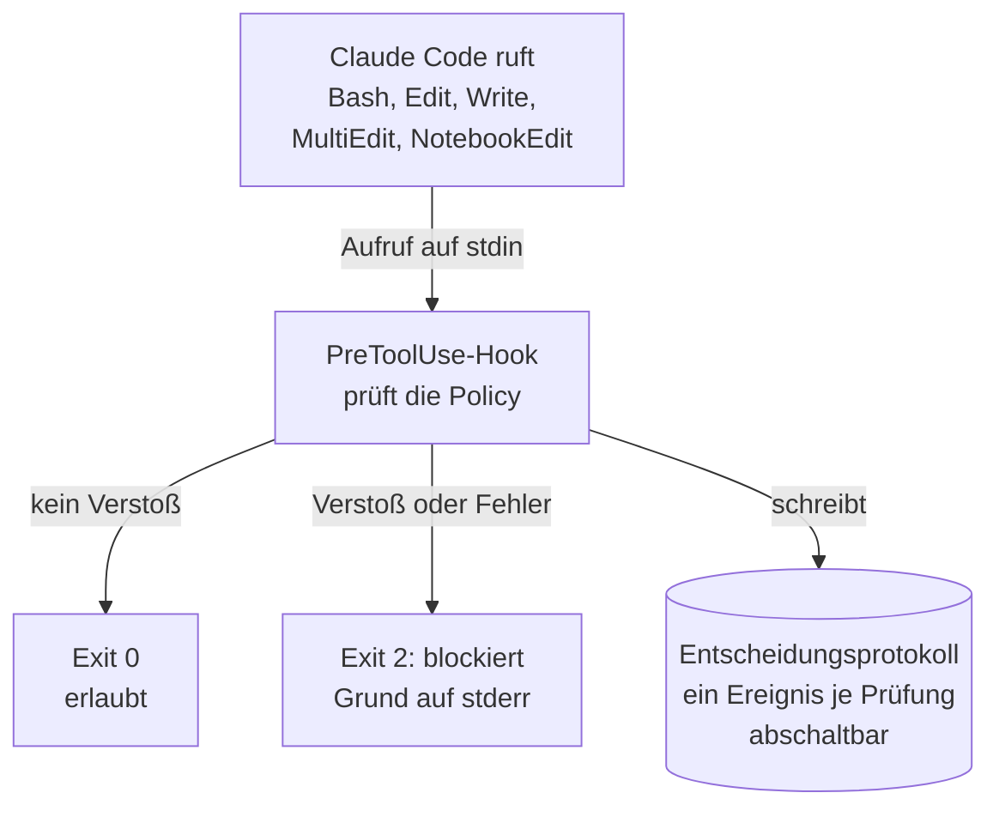
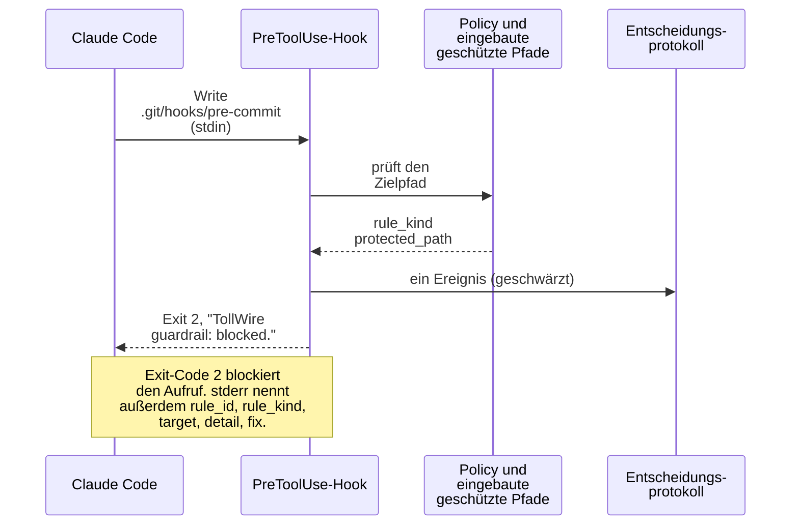
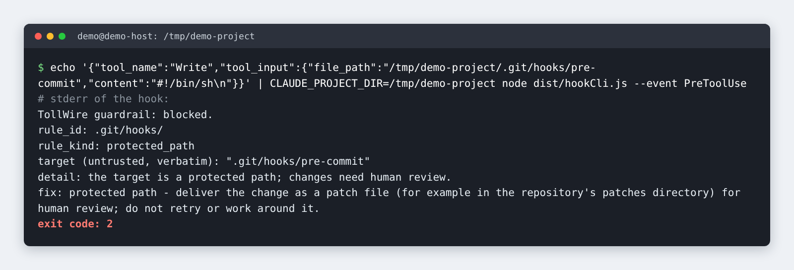
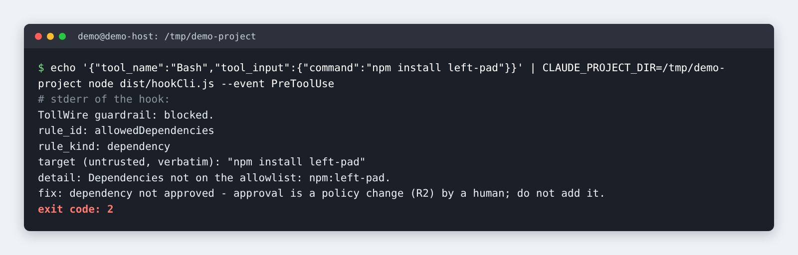
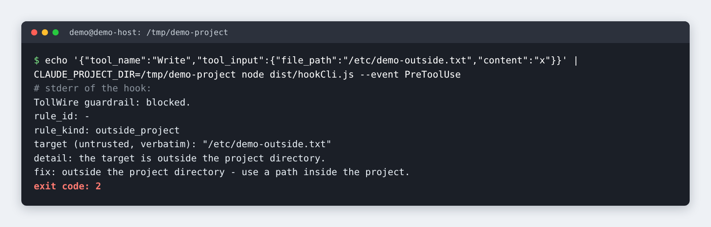
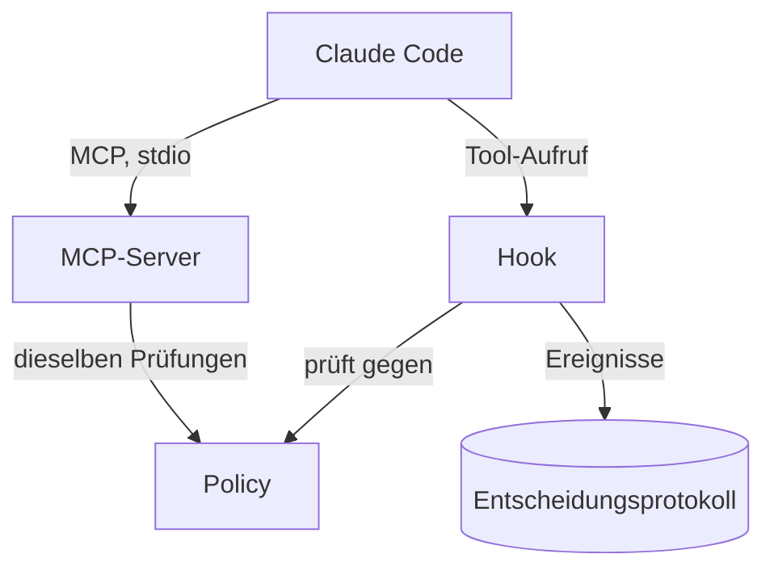
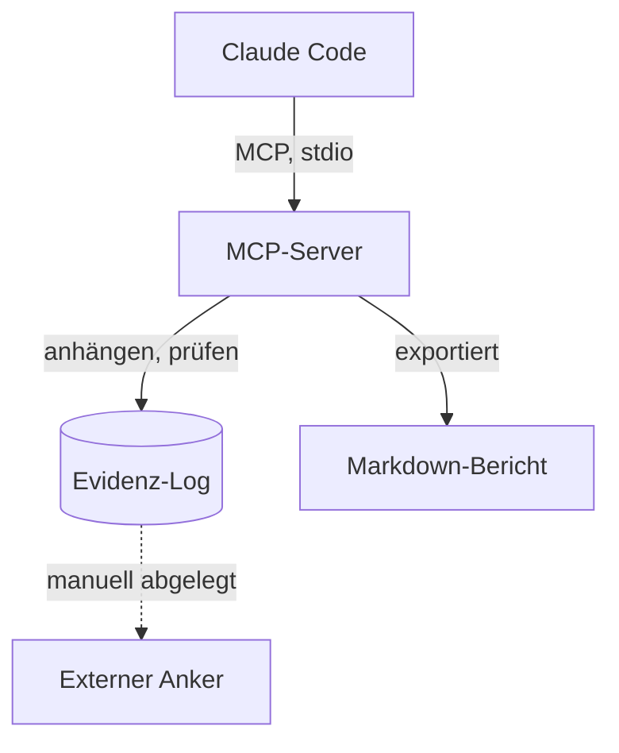
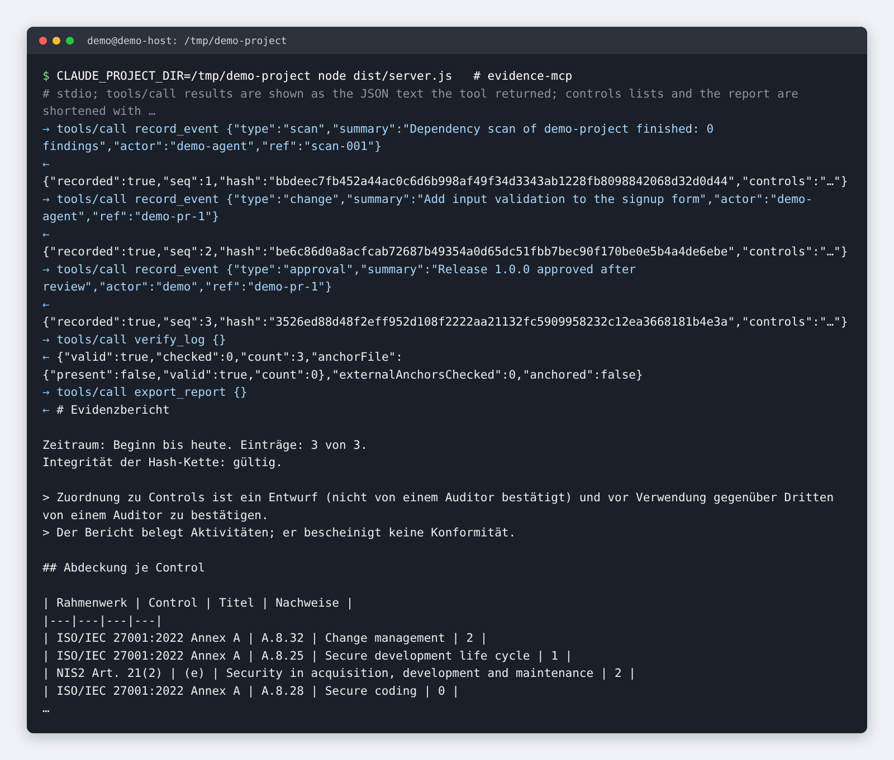
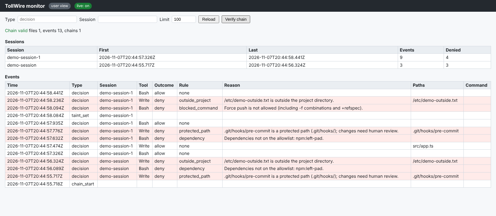

# TollWire

[](https://www.npmjs.com/package/@tollwire/guardrail-plugin)
[](https://www.npmjs.com/package/@tollwire/evidence-mcp)
[](LICENSE)
[](#installation-über-npm)

TollWire ergänzt KI-Coding-Agenten um eine Kontrollschicht: Es prüft Schreibzugriffe, Shell-Befehle und neue Abhängigkeiten vor der Ausführung, blockiert erkannte Verstöße und führt ein manipulationserkennendes Protokoll über gemeldete Änderungen, Scans und Freigaben, das Sie als Nachweis in Audits verwenden können. Der Code läuft lokal.

Englische Hauptfassung: [README.md](README.md)

> [!IMPORTANT]
> **Release-Stand: Version 0.1.3.** Schnittstellen können sich vor 1.0
> inkompatibel ändern.
>
> **Lizenz:** quelloffen einsehbar, aber kein Open Source: [PolyForm Noncommercial License 1.0.0](LICENSE). Nur nicht-kommerzielle Nutzung; kommerzielle Nutzung braucht vorherige schriftliche Zustimmung (Textform, z. B. E-Mail). Siehe [Lizenz](#lizenz) und [LEGAL.md](LEGAL.md).

> [!WARNING]
> **Keine Sandbox:** TollWire ist Verteidigung in der Tiefe, keine Sicherheitsgrenze. Siehe [Grenzen](#grenzen). Für nicht vertrauenswürdigen Code betreiben Sie den Agenten in einem Container oder einer Sandbox; TollWire legt die Policy-Guardrail und einen manipulationserkennenden Audit-Trail darüber, kein Ersatz dafür.

[Was ist TollWire?](#was-ist-tollwire) · [So funktioniert es](#so-funktioniert-es) · [Architektur](#architektur) · [Schnellstart](#schnellstart) · [Sicherheitshinweise](#sicherheitshinweise) · [Grenzen](#grenzen) · [Dokumentation](#dokumentation)

## Was ist TollWire?

TollWire enthält zwei lokale, quelloffen einsehbare Plugins (PolyForm Noncommercial License 1.0.0, nur nicht-kommerzielle Nutzung, siehe [Lizenz](#lizenz)):

| Plugin | Paket | Funktion |
|---|---|---|
| `tollwire-guardrail` | [`guardrail-plugin/`](guardrail-plugin/README.md) | Blockiert erkannte Schreibzugriffe auf geschützte Pfade, gefährliche Shell-Befehle und Abhängigkeiten, die nicht auf der Allowlist stehen, bevor der Tool-Aufruf läuft (PreToolUse-Hook). Dieselben Prüfungen stehen als MCP-Tools zur Verfügung. |
| `tollwire-evidence` | [`evidence-mcp/`](evidence-mcp/README.md) | MCP-Server, der Änderungen, Reviews, Scans, Freigaben, Deployments, Vorfälle und Rechteänderungen von Agenten in einem Hash-Ketten-Log protokolliert. Er prüft die Kette, legt externe Anker an, ordnet Ereignistypen Controls aus ISO/IEC 27001:2022 Annex A und NIS2 Artikel 21 Absatz 2 zu (Entwurf) und exportiert einen Markdown-Bericht. |

Beide Plugins laufen als lokale Prozesse auf Ihrem Rechner. Das Projekt betreibt keinen gehosteten Dienst.
Der Plugin-Code führt keine Netzwerkaufrufe aus.
Abgesehen von dem, was Ihre eigenen Werkzeuge tun (zum Beispiel Claude Code oder npm bei der Paketinstallation), verlassen durch TollWire keine Daten Ihren Rechner. Das Evidenz-Log ist eine Datei im Projektverzeichnis; Einzelheiten stehen im Paket `evidence-mcp`.

## So funktioniert es

Was geschieht, wenn Claude Code ein geprüftes Werkzeug aufruft. Einzelheiten: [Sicherheitshinweise](#sicherheitshinweise).



### Ein blockierter Aufruf

Der Aufruf aus Screenshot 1 unten: ein `Write` auf `.git/hooks/pre-commit`.



> [!NOTE]
> Ausgabe des gebauten Codes (Guardrail-Plugin und Evidenz-Server 0.1.3, Monitor 0.1.0) in einem temporären Demo-Projekt mit
> dem Demo-Konto `demo@demo-host`. Lange Teile sind mit „…“ gekürzt. Die Bilder sind englische Programmausgabe, außer dem
> Bericht in Bild 5. Einige technische Kennungen tragen noch den früheren Namen (siehe [Namen](#namen)). Ein Klick auf ein
> Bild zeigt es in voller Größe.

| Geschützter Pfad | Abhängigkeit nicht auf der Allowlist | Außerhalb des Projektverzeichnisses |
|---|---|---|
|  |  |  |
| Der Guardrail-Hook blockiert ein `Write` auf `.git/hooks/pre-commit`, bevor es ausgeführt wird (Regelart `protected_path`, Exit-Code 2). | Der Guardrail-Hook blockiert `npm install left-pad`, weil das Paket nicht auf der Allowlist für Abhängigkeiten steht. | Der Guardrail-Hook blockiert ein `Write` auf `/etc/demo-outside.txt`, weil das Ziel außerhalb des Projektverzeichnisses liegt (Regelart `outside_project`, Exit-Code 2). |

## Architektur

Die Komponenten der beiden Plugins und wie sie zusammenhängen. Jedes Plugin wird einzeln installiert.

**Guardrail-Plugin** (`tollwire-guardrail`)



**Evidenz-Plugin** (`tollwire-evidence`)



| Komponente | Was sie tut | Werkzeuge |
|---|---|---|
| Hook | Befehl: `node dist/hookCli.js`. PreToolUse: prüft, kann blockieren. PostToolUse und Sitzungsereignisse: nur Protokoll. | – |
| Policy | Projekt-Policy, sonst die mitgelieferte `policy/default.json`. | – |
| MCP-Server (Guardrail) | Befehl: `node dist/mcp/server.js`. Dieselben Prüfungen wie der Hook. | `check_command`, `check_path`, `check_dependencies`, `describe_policy` |
| Entscheidungsprotokoll | Hash-verkettet, JSON Lines. | – |
| MCP-Server (Evidenz) | Befehl: `node dist/server.js`. | `record_event`, `list_events`, `verify_log`, `create_anchor`, `map_controls`, `export_report` |
| Evidenz-Log | JSON Lines im Projektverzeichnis, Hash-Kette, Ankerdatei. | – |
| Markdown-Bericht | Ausgabe von `export_report`. | – |
| Externer Anker | Zum Beispiel ein signierter Git-Tag: `create_anchor`, dann von einer Person abgelegt. | – |

- **Hook:** Claude Code startet den Hook vor `Bash`, `Edit`, `Write`, `MultiEdit` und `NotebookEdit`. Exit-Code 2
  blockiert den Aufruf; der Grund wird auf stderr ausgegeben. Beobachtete Werkzeuge (nur Protokoll) und
  Sitzungsereignisse blockieren nie. Einzelheiten: [Sicherheitshinweise](#sicherheitshinweise) und die
  [Guardrail-README](guardrail-plugin/README.md).
- **Entscheidungsprotokoll:** Jede Prüfung eines Tool-Aufrufs schreibt ein Ereignis in ein hash-verkettetes Protokoll
  in Ihren Benutzerverzeichnissen ([Ereignisschema](guardrail-plugin/docs/events-v1.md)); Sie können es in Ihrer
  Benutzerkonfiguration abschalten (Plugin-README, „Decision log“).
- **Evidenz-Log:** ein Log im JSON-Lines-Format im Projektverzeichnis. Ein Anker wirkt nur, wenn er außerhalb des
  Rechners abgelegt ist; die Werkzeuge signieren nichts ([Evidence-README](evidence-mcp/README.md)).

| Evidenz-Log und Bericht | Benutzeransicht des Monitors |
|---|---|
|  |  |
| Der Evidenz-MCP-Server: drei Aufrufe von `record_event` (Scan, Änderung, Freigabe), `verify_log` und `export_report`. Die Control-Tabelle des Berichts ist gekürzt. | Die Benutzeransicht des lokalen Monitors nach „Verify chain“: Die Kette ist gültig (eine Datei, 13 Ereignisse), zwei Demo-Sitzungen mit ihrer Zahl an Ereignissen und Ablehnungen sowie die Ereignisliste mit Tool, Ergebnis, Regel und Grund; abgelehnte Ereignisse sind hervorgehoben. |

## Schnellstart

Guardrail und Evidenz-Log als Claude-Code-Plugins, drei Befehle in Claude Code:

```text
/plugin marketplace add TollWire/tollwire
/plugin install tollwire-guardrail@tollwire
/plugin install tollwire-evidence@tollwire
```

Jedes Plugin wird einzeln installiert; Sie können auch nur die Guardrail installieren. Eine Installation als Bündel in
einem Schritt gibt es noch nicht.

Nur der Evidence-MCP-Server (statt des Plugins `tollwire-evidence`), ein Befehl in der Shell:

```bash
claude mcp add tollwire-evidence -- npx -y @tollwire/evidence-mcp
```

Sie brauchen Node.js 22.12 oder neuer und npm im `PATH` ([Voraussetzungen](#voraussetzungen)). Lesen Sie vor der
Installation die [Sicherheitshinweise](#sicherheitshinweise); wie Sie alles wieder entfernen, steht unter
[Deinstallation](#deinstallation). Für vom Administrator verwaltete Linux-Rechner gibt es eine eigene
[Enterprise-Ausgabe](#enterprise-ausgabe-linux).

## Installation über den Claude-Code-Plugin-Marketplace

<details>
<summary>Befehle, Festlegen auf einen Release-Tag, Bereiche, automatische Aktualisierung</summary>

In Claude Code:

```text
/plugin marketplace add TollWire/tollwire
/plugin install tollwire-guardrail@tollwire
/plugin install tollwire-evidence@tollwire
```

Um den Marketplace auf einen Release-Tag festzulegen:

```text
/plugin marketplace add TollWire/tollwire#<tag>
```

Über die Kommandozeile:

```bash
claude plugin marketplace add TollWire/tollwire
claude plugin install tollwire-guardrail@tollwire --scope user
claude plugin install tollwire-evidence@tollwire --scope user
```

`--scope` akzeptiert `user`, `project` oder `local`. Was die einzelnen Bereiche bedeuten, steht in der Installationsdokumentation.

Die automatische Aktualisierung ist für Marketplaces Dritter standardmäßig aus. Die Einträge im Marketplace verwenden exakte Paketversionen.

</details>

## Installation über npm

Wählen Sie **einen** Weg: die Marketplace-Installation oben oder die npm-Installation unten. Beides zugleich kann dieselben MCP-Server doppelt registrieren.

Der npm-Weg gilt nur für den Evidence-MCP-Server. Die Guardrail braucht ihren PreToolUse-Hook, den nur die Plugin-Installation registriert; installieren Sie die Guardrail daher über den Marketplace.

<details>
<summary>Befehle, <code>.mcp.json</code>, Version festlegen, MCP Registry, Installationsskripte</summary>

Den Evidence-Server für Ihr Benutzerkonto registrieren:

```bash
claude mcp add --scope user --transport stdio tollwire-evidence -- npx -y @tollwire/evidence-mcp
```

Oder in die `.mcp.json` Ihres Projekts eintragen:

```json
{
  "mcpServers": {
    "tollwire-evidence": {
      "command": "npx",
      "args": ["-y", "@tollwire/evidence-mcp"]
    }
  }
}
```

Um eine Version zu verwenden, die Sie geprüft haben, legen Sie sie fest: `npx -y @tollwire/evidence-mcp@<exakte-version>`.

Der Evidence-Server steht seit Version 0.1.2 auch in der offiziellen MCP Registry, als `io.github.TollWire/evidence-mcp`.

Die Pakete deklarieren keine Installationsskripte. Wenn Sie ein Paket selbst mit npm installieren, verhindert `--ignore-scripts`, dass npm Lebenszyklusskripte ausführt.

</details>

## Voraussetzungen

- Node.js 22, Version 22.12.0 oder neuer (das Feld `engines` beider Pakete).
- Claude Code mit Unterstützung für Plugins; getestet mit Claude Code 2.1.302 (Guardrail-Plugin, 2026-10-30).
- npm im `PATH`. Nach einer Marketplace-Installation installiert Claude Code die Paketabhängigkeiten mit npm. Fehlen die Laufzeitabhängigkeiten, blockiert der Guardrail-Hook Aufrufe von Bash, Edit, Write, MultiEdit und NotebookEdit (siehe [Sicherheitshinweise](#sicherheitshinweise)).

## Sicherheitshinweise

> [!WARNING]
> Ein Claude-Code-Plugin, das Sie installieren, kann beliebigen Code auf Ihrem Rechner mit Ihren Benutzerrechten ausführen. Hooks und MCP-Server laufen außerhalb der Sandbox von Claude Code. Quelle: [Claude Code plugin security](https://code.claude.com/docs/en/plugins/security) (Wortlaut am 2026-10-24 gegen die Quelle geprüft).

### Was `tollwire-guardrail` ausführt

<details>
<summary>Hook, Fail closed, Zeitlimit, macOS, MCP-Server, Logs</summary>

- **Hook:** PreToolUse für `Bash`, `Edit`, `Write`, `MultiEdit` und `NotebookEdit`. Er startet `node dist/hookCli.js` und liest den Tool-Aufruf von stdin. Exit-Code 2 blockiert den Aufruf; der Grund wird auf stderr ausgegeben.
- **Fail closed:** Bei den geprüften Werkzeugen (`Bash`, `Edit`, `Write`, `MultiEdit`, `NotebookEdit`): Fehlt `node` oder `dist/hookCli.js` oder lädt es nicht, oder beendet sich der Hook mit einem anderen Code als 0 oder 2, beendet der Wrapper sich mit 2 und der Aufruf wird blockiert. Beobachtete Werkzeuge (nur Protokoll) und Sitzungsereignisse blockieren nie. Die Meldung beginnt mit `TollWire guardrail: hook did not run or timed out`. Prüfen Sie dann, ob `node` im `PATH` liegt und die Abhängigkeiten des Plugins installiert sind, oder deaktivieren Sie das Plugin.
- **Zeitlimit:** `hooks/hooks.json` setzt 30 Sekunden. Ist GNU `timeout` installiert, beendet der Wrapper den Hook nach 25 Sekunden. Ohne `timeout` (zum Beispiel bei der Standardeinrichtung unter macOS) startet der Wrapper den Hook mit einem eingebauten Watchdog (`dist/hookCliPosix.js`), der den Prozess nach 25 Sekunden beendet; für die geprüften Werkzeuge ist das eine Sperre (Exit-Code 2). Was Claude Code bei Ablauf des eigenen 30-Sekunden-Limits tut, ist nicht geprüft.
- **macOS:** Pfadvergleiche für geschützte Pfade ignorieren Groß-/Kleinschreibung und Unicode-Normalform, weil APFS das standardmäßig tut (`.CLAUDE/settings.json` ist dieselbe Datei wie `.claude/settings.json`). `Library/LaunchAgents/` und `Library/Application Support/Claude/` im Home-Verzeichnis sind geschützte Pfade. Der Unternehmensmodus für macOS (vom Administrator verwaltet, mit einer root-eigenen Policy) gehört zu einem eigenen kommerziellen Paket und ist in diesem Plugin-Build nicht aktiv: Ist ein Administrator-Verzeichnis vorhanden, sind die geprüften Werkzeuge gesperrt (`enterprise_unsupported_platform`), bis der Modus auf echter Hardware abgenommen ist. Ohne dieses Verzeichnis verhält sich das Plugin wie in diesem Dokument beschrieben.
- **MCP-Server:** stdio, gestartet mit `node dist/mcp/server.js`. Tools: `check_command`, `check_path`, `check_dependencies`, `describe_policy`. Der Server schreibt keine Dateien.
- **Logs:** Das Plugin schreibt ein lokales Protokoll seiner Entscheidungen (geschwärzt); Sie können es in Ihrer Benutzerkonfiguration abschalten. Standardmäßig enthält es keinen Befehlstext, und nichts wird irgendwohin gesendet. Ort, Aufbewahrung und Schalter stehen in der Plugin-README ("Decision log"). Hook-Meldungen gehen auf stderr.

</details>

### Was `tollwire-evidence` ausführt

<details>
<summary>MCP-Server, Schreibt, Inhalt</summary>

- **MCP-Server:** stdio, gestartet mit `node dist/server.js`. Tools: `record_event`, `list_events`, `verify_log`, `create_anchor`, `map_controls`, `export_report`.
- **Schreibt:** ein Log im JSON-Lines-Format. Der Pfad ist `TOLLGATE_EVIDENCE_LOG`, wenn gesetzt; sonst `.tollgate/evidence/log.jsonl` im Projektverzeichnis (`CLAUDE_PROJECT_DIR` oder das aktuelle Verzeichnis). Dateien werden mit Modus 0600 angelegt. Neben dem Log entstehen eine Sperrdatei und eine Ankerdatei (`log.jsonl.anchors.jsonl`). Symbolische Links im Pfad werden abgelehnt.
- **Inhalt:** Das Log enthält, was erfasst wird, einschließlich des angegebenen `actor`. Erfassen Sie keine Geheimnisse. Der Server lehnt nur einige bekannte Geheimnisformate ab, nicht alle.

</details>

### Vor der Installation

- Lesen Sie `hooks/hooks.json` und `.mcp.json` im Paket. Sie zeigen genau, was Claude Code ausführt.
- Prüfen Sie das Release: Laden Sie die `.tgz`-Datei und die Datei `SHA256SUMS` aus dem GitHub-Release der installierten Version herunter und führen Sie in diesem Verzeichnis `sha256sum --check --strict SHA256SUMS` aus. Der Marketplace-Eintrag enthält keinen Integritäts-Digest. Diese Prüfung betrifft die heruntergeladene Datei, nicht die Kopie, die npm ausliefert.
- Abgleich mit der Kopie, die npm ausliefert: `npm view @tollwire/<paket>@<version> dist.integrity` muss gleich
  `sha512-` gefolgt von `openssl dgst -sha512 -binary <datei>.tgz | openssl base64 -A` der geprüften Datei sein.
- Legen Sie die Version fest: `#<tag>` für den Marketplace, eine exakte Version für `npx`.
- Die automatische Aktualisierung von Marketplaces Dritter ist standardmäßig aus. Lassen Sie sie aus, solange Sie das Release nicht geprüft haben.

### Deinstallation

Ein Plugin deaktivieren Sie unter `/plugin` oder deinstallieren es:

```bash
claude plugin uninstall tollwire-guardrail@tollwire --scope user
claude plugin uninstall tollwire-evidence@tollwire --scope user
claude plugin marketplace remove tollwire
```

Verwenden Sie den Bereich (`--scope`) der Installation. Bei der npm-Installation entfernen Sie den Server mit `claude mcp remove tollwire-evidence` oder löschen den Eintrag in `.mcp.json`.

Die Deinstallation löscht Ihre Daten nicht: Das Evidenz-Log bleibt im Projekt (`.tollgate/evidence/`), Entscheidungsprotokoll und Benutzerkonfiguration der Guardrail bleiben in Ihren Benutzerverzeichnissen (Orte in der Plugin-README, „Decision log“). Löschen Sie sie selbst, wenn Sie sie nicht mehr brauchen.

## Grenzen

> [!WARNING]
> - TollWire ist Verteidigung in der Tiefe, keine Sicherheitsgrenze. Der Guardrail ist keine Sandbox.
> - Der Guardrail prüft Shell-Befehle heuristisch. Er analysiert nicht Skriptdateien (`bash x.sh`, `./x.sh`, `source x.sh`), Module (`python -m`), `make`, `npm run` oder andere Programme, die selbst Dateien schreiben. Solche Aufrufe sind erlaubt.
> - Der Hook wirkt nur, wenn Claude Code das Plugin oder die Projekteinstellungen lädt. Das Projektverzeichnis ist das Verzeichnis, aus dem Claude Code gestartet wurde.
> - Das Evidenz-Log erkennt Änderungen, verhindert sie aber nicht. Wer die ganze Datei neu schreibt, kann eine neue, in sich gültige Kette erzeugen. Externe Anker erkennen das nur bis zum letzten Anker. Einträge nach dem letzten Anker sind nicht geschützt.
> - Der Wert `actor` und Ereignisse vom Typ `anchor` sind Selbstauskünfte. Die Werkzeuge prüfen nicht, wer einen Eintrag angelegt hat.
> - Die Zuordnung zu Controls (ISO/IEC 27001:2022 Annex A, NIS2 Artikel 21 Absatz 2) ist ein Entwurf. Sie ist nicht auditiert und kein Nachweis der Konformität mit einer der beiden Normen.
> - Vor 1.0 können sich Schnittstellen inkompatibel ändern.

## Enterprise-Ausgabe (Linux)

Für Rechner, die ein Administrator verwaltet, gibt es eine eigene, kommerzielle Enterprise-Ausgabe: eine root-eigene
Policy, die Benutzer und Agenten nicht ändern können, ein festes System-Node, Weiterleitung des Entscheidungsprotokolls
an Ihr SIEM und eine Admin-Ansicht. Sie ist nicht Teil dieses Repositorys; anfragen über den Weg in
[LEGAL.md](LEGAL.md). Linux kommt zuerst; macOS und Windows sind geplant.

<details>
<summary>Installation, Trockenlauf und Prüfungen</summary>

Das Enterprise-Paket wird mit einem Befehl installiert, zuerst als Trockenlauf (als normaler Benutzer starten; wo root
nötig ist, fragt es nach `sudo`):

```bash
sh install/linux/setup.sh --dry-run    # zeigt jeden Schritt, ändert nichts
sh install/linux/setup.sh              # Node-Prüfung, Bau, root-eigene Kopie, Installation, Provisionierung, Systemprüfung
```

Erhalten Sie das Paket als Archiv, prüfen Sie es vor dem Entpacken: `sha256sum --check --strict SHA256SUMS` im
Download-Verzeichnis. Das Installationsprogramm lädt nichts herunter, und es gibt keine `curl | sh`-Variante.
Installieren Sie es nur auf einem eigenen Test- oder verwalteten Rechner: Danach läuft die Guardrail auf diesem Rechner
im Unternehmensmodus (fail closed).

</details>

## Namen

<details>
<summary>Meldungsnamen und technische Kennungen</summary>

Meldungen an Sie tragen den Namen TollWire (`TollWire guardrail: …`, seit Version 0.1.3). Einige technische Kennungen
tragen noch den früheren Namen TollGate: Umgebungsvariablen (`TOLLGATE_*`), Verzeichnisse (`.tollgate/`,
`/etc/tollgate/`), das Ereignisschema `tollgate.event.v1` und die MCP-Servernamen in den Plugins (`tollgate-guardrail`,
`tollgate-evidence`). Sie funktionieren wie beschrieben. Ein späteres Release kann sie umbenennen; die Release-Notes
sagen es dann.

</details>

## Beitragen und Sicherheit

- [CONTRIBUTING.md](CONTRIBUTING.md): Issues und Fehlerberichte sind willkommen; Pull Requests von Dritten werden nicht angenommen.
- [SECURITY.md](SECURITY.md): Sicherheitslücken vertraulich melden, nicht als öffentliches Issue.

## Lizenz

Quelloffen einsehbar, aber kein Open Source: [PolyForm Noncommercial License 1.0.0](LICENSE) (SPDX: `PolyForm-Noncommercial-1.0.0`). Nur nicht-kommerzielle Nutzung; kommerzielle Nutzung braucht vorherige schriftliche Zustimmung (Textform, z. B. E-Mail). Zusammenfassung, Anfrageweg und Details: [LEGAL.md](LEGAL.md). Siehe auch [NOTICE](NOTICE).

## Dokumentation

- [Guardrail-Plugin](guardrail-plugin/README.md): was es prüft, Hook und Fail-closed-Verhalten, Entscheidungsprotokoll, Session-Taint, Policy, Grenzen (englisch).
- [Ereignisschema des Entscheidungsprotokolls](guardrail-plugin/docs/events-v1.md): Felder, Hash-Kette, Prüfung (englisch).
- [Evidence-MCP-Server](evidence-mcp/README.md): Tools, Speicherung, externe Anker, Grenzen (englisch).
- [Sicherheitshinweise](#sicherheitshinweise) und [Grenzen](#grenzen) in dieser README.
- [SECURITY.md](SECURITY.md): Sicherheitslücken vertraulich melden.
- [CONTRIBUTING.md](CONTRIBUTING.md): Issues und Fehlerberichte.
- [LEGAL.md](LEGAL.md), [LICENSE](LICENSE) und [NOTICE](NOTICE): Zusammenfassung der Lizenz, Anfrageweg und Lizenztext.
- [Releases](https://github.com/TollWire/tollwire/releases): Pakete (`.tgz`) und `SHA256SUMS` je Version.
- [Claude Code plugin security](https://code.claude.com/docs/en/plugins/security): was ein installiertes Plugin ausführen kann.
- [Englische Hauptfassung](README.md)
