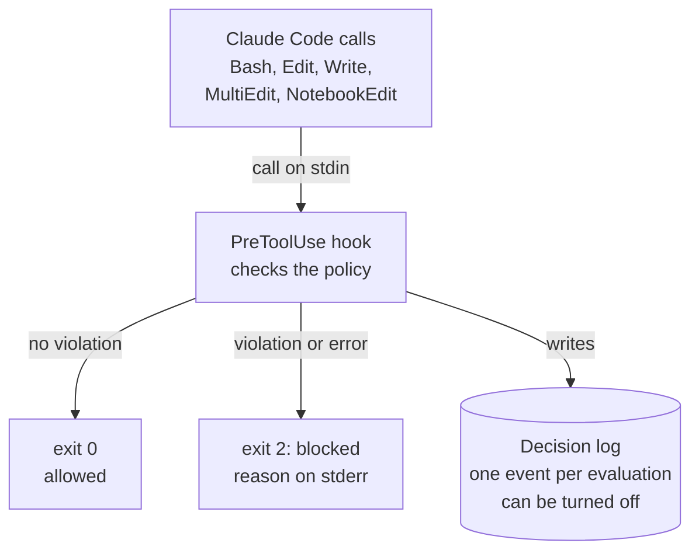
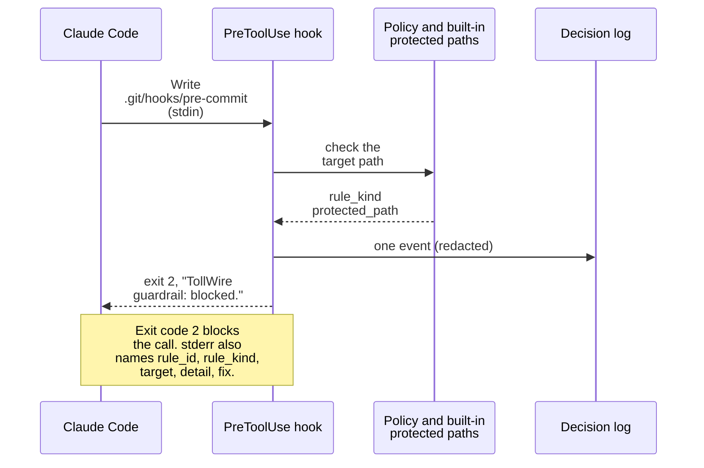
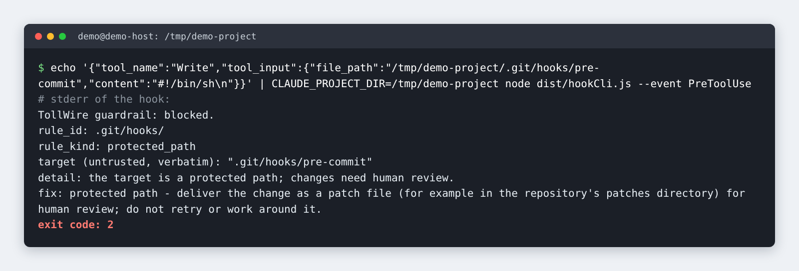
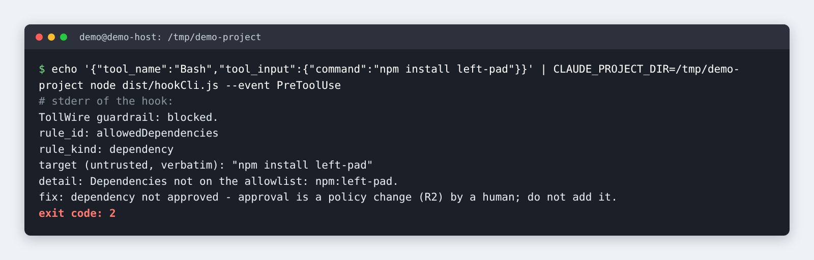
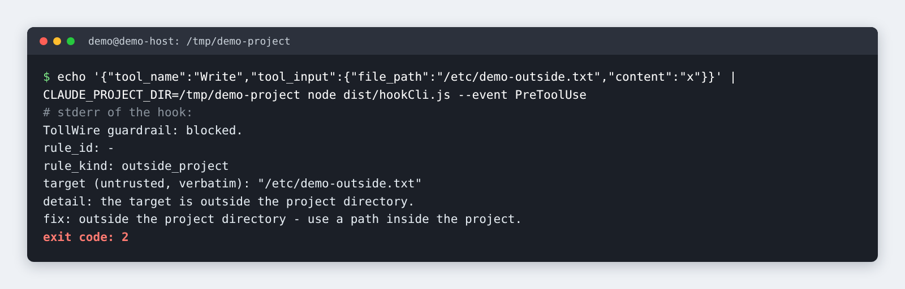
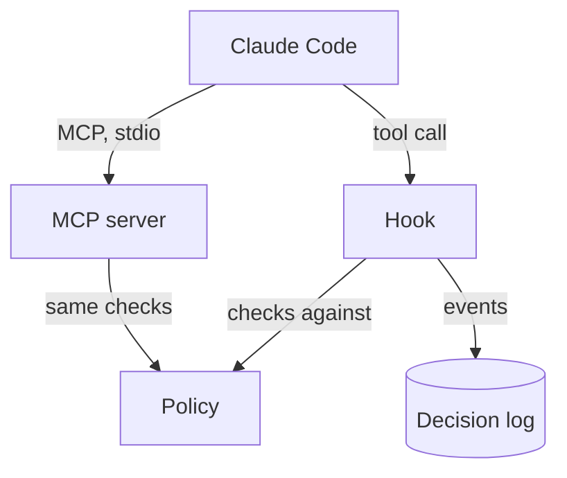
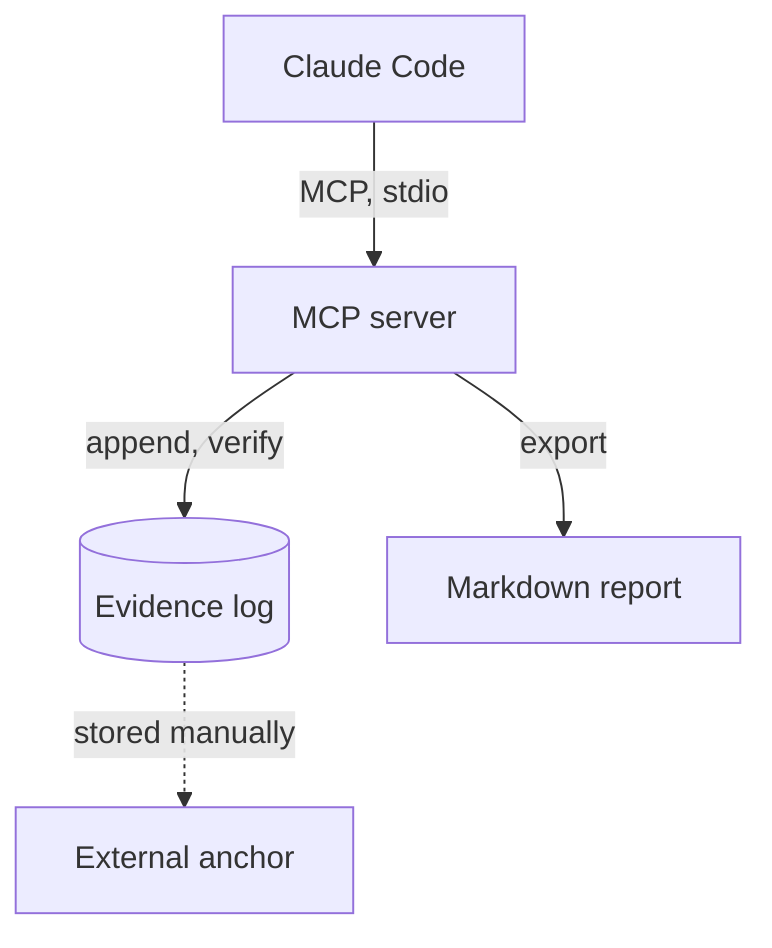
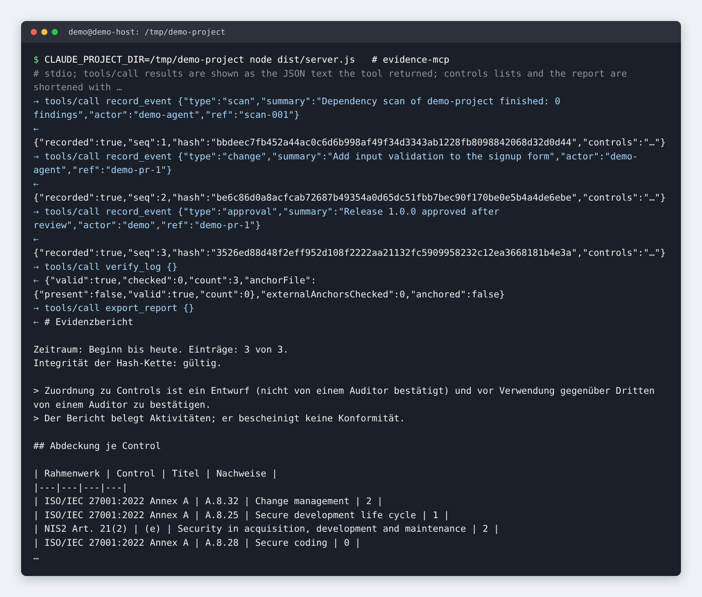
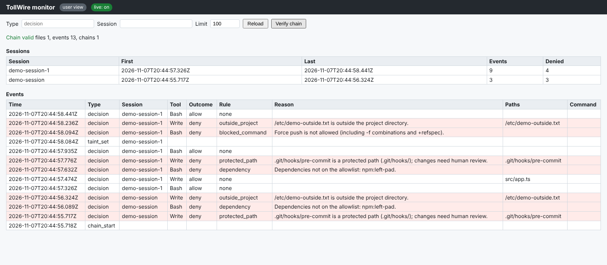

# TollWire

[](https://www.npmjs.com/package/@tollwire/guardrail-plugin)
[](https://www.npmjs.com/package/@tollwire/evidence-mcp)
[](LICENSE)
[](#install-via-npm)

TollWire adds a policy enforcement layer to AI coding agents: it checks file writes, shell commands and new dependencies before they run, blocks detected violations, and keeps a tamper-evident log of reported changes, scans and approvals that you can use as evidence in audits. The code runs locally.

> **License & Commercial Evaluation (PoC):**\
> TollWire is source-available under the **PolyForm Noncommercial License 1.0.0** (free for personal, academic, and noncommercial use).\
> **Looking for Pilot Teams:** Organizations and engineering teams evaluating TollWire in a commercial environment can request a **free, time-limited Proof-of-Concept (PoC) license** before transitioning to a paid Enterprise agreement. To start a pilot or request the Enterprise Edition, please reach out via the contact details in [LEGAL.md](LEGAL.md).

German version: [README.de.md](README.de.md)

> [!IMPORTANT]
> **Release status: version 0.1.6.** Interfaces can change incompatibly before 1.0.
>
> **License:** source-available, not open source: [PolyForm Noncommercial License 1.0.0](LICENSE). Noncommercial use only; commercial use requires prior permission in writing (text form, e.g. e-mail). See [License](#license) and [LEGAL.md](LEGAL.md).

> [!WARNING]
> **Not a sandbox:** TollWire is defense in depth, not a security boundary. See [Limits](#limits). For untrusted code, run the agent in a container or sandbox; TollWire adds the policy guardrail and a tamper-evident audit trail over that boundary, not a replacement for it.

[What is TollWire?](#what-is-tollwire) · [How it works](#how-it-works) · [Architecture](#architecture) · [Quick start](#quick-start) · [Security notes](#security-notes) · [Limits](#limits) · [Documentation](#documentation)

## What is TollWire?

TollWire contains two local, source-available plugins (PolyForm Noncommercial License 1.0.0, noncommercial use only, see [License](#license)):

| Plugin | Package | What it does |
|---|---|---|
| `tollwire-guardrail` | [`guardrail-plugin/`](guardrail-plugin/README.md) | Blocks recognized writes to protected paths, dangerous shell commands and dependencies that are not on the allowlist, before the tool call runs (PreToolUse hook). The same checks are available as MCP tools. |
| `tollwire-evidence` | [`evidence-mcp/`](evidence-mcp/README.md) | MCP server that records agent changes, reviews, scans, approvals, deployments, incidents and permission changes in a hash-chained log. It verifies the chain, creates external anchors, maps event types to ISO/IEC 27001:2022 Annex A and NIS2 Article 21(2) controls (draft), and exports a Markdown report. |

Both plugins run as local processes on your machine. The project does not operate a hosted service.
The plugin code makes no network requests.
Apart from what your own tools do (for example Claude Code or npm when they install packages), no data leaves your machine through TollWire. The evidence log is a file in your project directory; see the evidence package for details.

## How it works

What happens when Claude Code calls a checked tool. Details: [Security notes](#security-notes).



### A blocked call

The call from screenshot 1 below: a `Write` to `.git/hooks/pre-commit`.



> [!NOTE]
> Output of the built code (guardrail plugin and evidence server 0.1.3, monitor 0.1.0) in a temporary demo project with the
> demo account `demo@demo-host`. Long parts are shortened with "…". Some technical identifiers still carry the former name
> (see [Naming](#naming)). Select an image to see it in full size.

| Protected path | Dependency not on the allowlist | Outside the project directory |
|---|---|---|
|  |  |  |
| The guardrail hook blocks a `Write` to `.git/hooks/pre-commit` before it runs (rule kind `protected_path`, exit code 2). | The guardrail hook blocks `npm install left-pad` because the package is not on the dependency allowlist. | The guardrail hook blocks a `Write` to `/etc/demo-outside.txt` because the target is outside the project directory (rule kind `outside_project`, exit code 2). |

## Architecture

The components of the two plugins and how they connect. Each plugin is installed on its own.

**Guardrail plugin** (`tollwire-guardrail`)



**Evidence plugin** (`tollwire-evidence`)



| Component | What it does | Tools |
|---|---|---|
| Hook | Command: `node dist/hookCli.js`. PreToolUse: checks, can block. PostToolUse and session events: log only. | – |
| Policy | Project policy, else the bundled `policy/default.json`. | – |
| MCP server (guardrail) | Command: `node dist/mcp/server.js`. Same checks as the hook. | `check_command`, `check_path`, `check_dependencies`, `describe_policy` |
| Decision log | Hash-chained, JSON Lines. | – |
| MCP server (evidence) | Command: `node dist/server.js`. | `record_event`, `list_events`, `verify_log`, `create_anchor`, `map_controls`, `export_report` |
| Evidence log | JSON Lines in the project directory, hash chain, anchor file. | – |
| Markdown report | Output of `export_report`. | – |
| External anchor | For example a signed Git tag: `create_anchor`, then stored by a person. | – |

- **Hook:** Claude Code runs the hook before `Bash`, `Edit`, `Write`, `MultiEdit` and `NotebookEdit`. Exit code 2
  blocks the call; the reason is written to stderr. Observed tools (log only) and session events never block. Details:
  [Security notes](#security-notes) and the [guardrail README](guardrail-plugin/README.md).
- **Decision log:** every evaluation of a tool call writes one event to a hash-chained log in your user directories
  ([event schema](guardrail-plugin/docs/events-v1.md)); you can turn it off in your user configuration (plugin README,
  "Decision log").
- **Evidence log:** a JSON Lines log in the project directory. An anchor is effective only when it is stored outside
  the machine; the tools never sign anything ([evidence README](evidence-mcp/README.md)).

| Evidence log and report | Monitor user view |
|---|---|
|  |  |
| The evidence MCP server: three `record_event` calls (scan, change, approval), `verify_log` and `export_report`. The report text is German (current product output); its control table is shortened. | The user view of the local monitor after "Verify chain": the chain is valid (one file, 13 events), two demo sessions with their event and denial counts, and the event list with tool, outcome, rule and reason; denied events are highlighted. |

## Quick start

Guardrail and evidence log as Claude Code plugins, three commands in Claude Code:

```text
/plugin marketplace add TollWire/tollwire
/plugin install tollwire-guardrail@tollwire
/plugin install tollwire-evidence@tollwire
```

Each plugin is installed on its own; you can install only the guardrail. There is no single bundle install yet.

Only the evidence MCP server (instead of the `tollwire-evidence` plugin), one command in a shell:

```bash
claude mcp add tollwire-evidence -- npx -y @tollwire/evidence-mcp
```

You need Node.js 22.12 or later and npm on your `PATH` ([Requirements](#requirements)). Read the
[Security notes](#security-notes) before you install, and see [Uninstall](#uninstall) to remove everything again.
For administrator-managed Linux machines there is a separate [enterprise edition](#enterprise-edition-linux).

## Install via the Claude Code plugin marketplace

<details>
<summary>Commands, pinning to a release tag, scopes, auto-update</summary>

In Claude Code:

```text
/plugin marketplace add TollWire/tollwire
/plugin install tollwire-guardrail@tollwire
/plugin install tollwire-evidence@tollwire
```

To pin the marketplace to a release tag:

```text
/plugin marketplace add TollWire/tollwire#<tag>
```

From the command line:

```bash
claude plugin marketplace add TollWire/tollwire
claude plugin install tollwire-guardrail@tollwire --scope user
claude plugin install tollwire-evidence@tollwire --scope user
```

`--scope` accepts `user`, `project` or `local`. See the install documentation for what each scope means.

Auto-update is off by default for marketplaces from third parties. The marketplace entries use exact package versions.

</details>

## Install via npm

Choose **one** path: the marketplace install above or the npm install below. Running both can register the same MCP servers twice.

The npm path is for the evidence MCP server only. The guardrail needs its PreToolUse hook, which only the plugin install registers, so install the guardrail through the marketplace.

<details>
<summary>Commands, <code>.mcp.json</code>, pinning, MCP Registry, install scripts</summary>

Register the evidence server for your user account:

```bash
claude mcp add --scope user --transport stdio tollwire-evidence -- npx -y @tollwire/evidence-mcp
```

Or add it to the `.mcp.json` of your project:

```json
{
  "mcpServers": {
    "tollwire-evidence": {
      "command": "npx",
      "args": ["-y", "@tollwire/evidence-mcp"]
    }
  }
}
```

To run a version you have reviewed, pin it: `npx -y @tollwire/evidence-mcp@<exact-version>`.

The evidence server is also listed in the official MCP Registry as `io.github.TollWire/evidence-mcp` (since version 0.1.2).

The packages declare no install scripts. If you install a package with npm yourself, `--ignore-scripts` prevents npm from running lifecycle scripts.

</details>

## Other coding agents (experimental)

Since version 0.1.6 the guardrail package also contains hook adapters for **OpenAI Codex CLI**, **GitHub Copilot CLI**,
**xAI Grok Build** and **Cursor Agent** (binaries `tollgate-guard-codex`, `tollgate-guard-copilot`, `tollgate-guard-grok`,
`tollgate-guard-cursor`). Each adapter passes the agent's pre-execution hook call to the same decision engine as the Claude
Code hook, so the same policy decides.

> [!NOTE]
> Experimental: the adapters are tested against the documented hook formats of each agent, not against every agent release.
> Copilot CLI and Grok Build allow a call when the hook times out or fails; Cursor does so unless the hook is registered with
> `"failClosed": true` (see the setup guide).
> The [Limits](#limits) apply unchanged.

Setup per agent: [guardrail-plugin/docs/multi-agent.md](guardrail-plugin/docs/multi-agent.md).

## Requirements

- Node.js 22, version 22.12.0 or later (the `engines` field of both packages).
- Claude Code with plugin support; tested with Claude Code 2.1.302 (guardrail plugin, 2026-10-30).
- npm on your `PATH`. After a marketplace install, Claude Code installs the package dependencies with npm. If the runtime dependencies are missing, the guardrail hook blocks Bash, Edit, Write, MultiEdit and NotebookEdit calls (see [Security notes](#security-notes)).

## Security notes

> [!WARNING]
> A Claude Code plugin you install can execute arbitrary code on your machine with your user privileges. Hooks and MCP servers run outside Claude Code's sandbox. Source: [Claude Code plugin security](https://code.claude.com/docs/en/plugins/security) (wording checked against the source on 2026-10-24).

### What `tollwire-guardrail` executes

<details>
<summary>Hook, fail closed, timeout, macOS, MCP server, logs</summary>

- **Hook:** PreToolUse for `Bash`, `Edit`, `Write`, `MultiEdit` and `NotebookEdit`. It runs `node dist/hookCli.js` and reads the tool call from stdin. Exit code 2 blocks the call; the reason is written to stderr.
- **Fail closed:** for the checked tools (`Bash`, `Edit`, `Write`, `MultiEdit`, `NotebookEdit`), if `node` or `dist/hookCli.js` is missing or does not load, or the hook exits with any code other than 0 or 2, the wrapper exits with 2 and the call is blocked. Observed tools (log only) and session events never block. The message starts with `TollWire guardrail: hook did not run or timed out`. Check that `node` is on your `PATH` and that the plugin dependencies are installed, or disable the plugin.
- **Timeout:** `hooks/hooks.json` sets 30 seconds. When GNU `timeout` is installed, the wrapper stops the hook after 25 seconds. Without `timeout` (for example with the default macOS setup) the wrapper starts the hook with a built-in watchdog (`dist/hookCliPosix.js`) that ends the process after 25 seconds; for the checked tools that is a block (exit code 2). What Claude Code itself does when its own 30-second limit passes has not been verified.
- **macOS:** path comparisons for protected paths ignore case and Unicode normalization form, because APFS does so by default (`.CLAUDE/settings.json` is the same file as `.claude/settings.json`). `Library/LaunchAgents/` and `Library/Application Support/Claude/` in the home directory are protected paths. The enterprise mode for macOS (managed by an administrator, with a root-owned policy) belongs to a separate commercial package and is not active in this plugin build: where an administrator directory is present, the checked tools are blocked (`enterprise_unsupported_platform`) until the mode has been accepted on real hardware. Without the administrator directory the plugin behaves as described in this document.
- **MCP server:** stdio, started with `node dist/mcp/server.js`. Tools: `check_command`, `check_path`, `check_dependencies`, `describe_policy`. The server does not write files.
- **Logs:** the plugin writes a local log of its decisions (redacted); you can turn it off in your user configuration. By default it contains no command text and nothing is sent anywhere. Location, retention and the switch are described in the plugin README ("Decision log"). Hook messages go to stderr.

</details>

### What `tollwire-evidence` executes

<details>
<summary>MCP server, writes, content</summary>

- **MCP server:** stdio, started with `node dist/server.js`. Tools: `record_event`, `list_events`, `verify_log`, `create_anchor`, `map_controls`, `export_report`.
- **Writes:** a JSON Lines log. The path is `TOLLGATE_EVIDENCE_LOG` if set; otherwise `.tollgate/evidence/log.jsonl` in the project directory (`CLAUDE_PROJECT_DIR`, or the current directory). Files are created with mode 0600. A lock file and an anchor file (`log.jsonl.anchors.jsonl`) are created next to the log. Symbolic links in the path are refused.
- **Content:** the log contains what is recorded, including the `actor` you name. Do not record secrets. The server refuses only some known secret formats, not all of them.

</details>

### Before you install

- Read `hooks/hooks.json` and `.mcp.json` in the package. They show exactly what Claude Code will run.
- Verify the release: download the `.tgz` and the `SHA256SUMS` file from the GitHub release of the version you install, then run `sha256sum --check --strict SHA256SUMS` in that directory. The marketplace entry has no integrity digest. This check covers the file you downloaded, not the copy that npm serves.
- Compare with the copy npm serves: `npm view @tollwire/<package>@<version> dist.integrity` must be equal to
  `sha512-` followed by `openssl dgst -sha512 -binary <file>.tgz | openssl base64 -A` for the file you checked.
- Pin the version: use `#<tag>` for the marketplace, and an exact version for `npx`.
- Auto-update of third-party marketplaces is off by default. Keep it off unless you have reviewed the release.

### Uninstall

Disable a plugin in `/plugin`, or uninstall it:

```bash
claude plugin uninstall tollwire-guardrail@tollwire --scope user
claude plugin uninstall tollwire-evidence@tollwire --scope user
claude plugin marketplace remove tollwire
```

Use the scope you installed with. For the npm install, remove the server with `claude mcp remove tollwire-evidence` or delete its entry from `.mcp.json`.

Uninstalling does not delete your data: the evidence log stays in the project (`.tollgate/evidence/`), the guardrail's decision log and user configuration stay in your user directories (locations in the plugin README, "Decision log"). Delete them yourself if you no longer need them.

## Limits

> [!WARNING]
> - TollWire is defense in depth, not a security boundary. The guardrail is not a sandbox.
> - The guardrail checks shell commands heuristically. It does not analyze script files (`bash x.sh`, `./x.sh`, `source x.sh`), modules (`python -m`), `make`, `npm run`, or other programs that write files themselves. Such calls are allowed.
> - The hook takes effect only if Claude Code loads the plugin or the project settings. The project directory is the directory from which Claude Code was started.
> - The evidence log detects changes; it does not prevent them. Whoever rewrites the whole file can create a new, internally valid chain. External anchors detect this only up to the last anchor. Entries after the last anchor are not protected.
> - The `actor` value and `anchor` events are self-declared. The tools do not verify who made an entry.
> - The control mapping (ISO/IEC 27001:2022 Annex A, NIS2 Article 21(2)) is a draft. It has not been audited and is not evidence of conformity with either standard.
> - Before 1.0, interfaces may change incompatibly.

## Enterprise edition (Linux)

For machines managed by an administrator there is a separate, commercial enterprise edition: a root-owned policy that
users and agents cannot change, a fixed system Node, forwarding of the decision log to your SIEM and an admin view.
It is not part of this repository; to ask for it, use the request route in [LEGAL.md](LEGAL.md). Linux comes first;
macOS and Windows are planned.

<details>
<summary>Install, dry run and checks</summary>

The enterprise package installs with one command, first as a dry run (run as a normal user; it asks for `sudo`
where root is needed):

```bash
sh install/linux/setup.sh --dry-run    # prints every step, changes nothing
sh install/linux/setup.sh              # Node check, build, root-owned copy, install, provisioning, system check
```

If you receive the package as an archive, check it before you unpack it: `sha256sum --check --strict SHA256SUMS` in
the download directory. The installer does not download anything and there is no `curl | sh` variant. Install it only
on a dedicated test or managed machine: once installed, the guardrail on that machine runs in enterprise mode (fail
closed).

</details>

## Naming

<details>
<summary>Message names and technical identifiers</summary>

Messages shown to you use the name TollWire (`TollWire guardrail: …`, since version 0.1.3). Some technical
identifiers still carry the former name TollGate: environment variables (`TOLLGATE_*`), directories (`.tollgate/`,
`/etc/tollgate/`), the event schema `tollgate.event.v1` and the MCP server names inside the plugins
(`tollgate-guardrail`, `tollgate-evidence`). They keep working as documented. A later release may rename them; the
release notes will say so.

</details>

## Contributing and security

- [CONTRIBUTING.md](CONTRIBUTING.md): issues and bug reports are welcome; pull requests from third parties are not accepted.
- [SECURITY.md](SECURITY.md): report vulnerabilities privately, not as public issues.

## License

Source-available, not open source: [PolyForm Noncommercial License 1.0.0](LICENSE) (SPDX: `PolyForm-Noncommercial-1.0.0`). Noncommercial use only; commercial use requires prior permission in writing (text form, e.g. e-mail). Summary, request route and details: [LEGAL.md](LEGAL.md). See also [NOTICE](NOTICE).

## Documentation

- [Guardrail plugin](guardrail-plugin/README.md): what it checks, hook and fail-closed behavior, decision log, session taint, policy, limits.
- [Decision log event schema](guardrail-plugin/docs/events-v1.md): fields, hash chain, verification.
- [Evidence MCP server](evidence-mcp/README.md): tools, storage, external anchors, limits.
- [Security notes](#security-notes) and [Limits](#limits) in this README.
- [SECURITY.md](SECURITY.md): report vulnerabilities privately.
- [CONTRIBUTING.md](CONTRIBUTING.md): issues and bug reports.
- [LEGAL.md](LEGAL.md), [LICENSE](LICENSE) and [NOTICE](NOTICE): license summary, request route and license text.
- [Releases](https://github.com/TollWire/tollwire/releases): packages (`.tgz`) and `SHA256SUMS` for each version.
- [Claude Code plugin security](https://code.claude.com/docs/en/plugins/security): what an installed plugin can execute.
- [German version](README.de.md)
